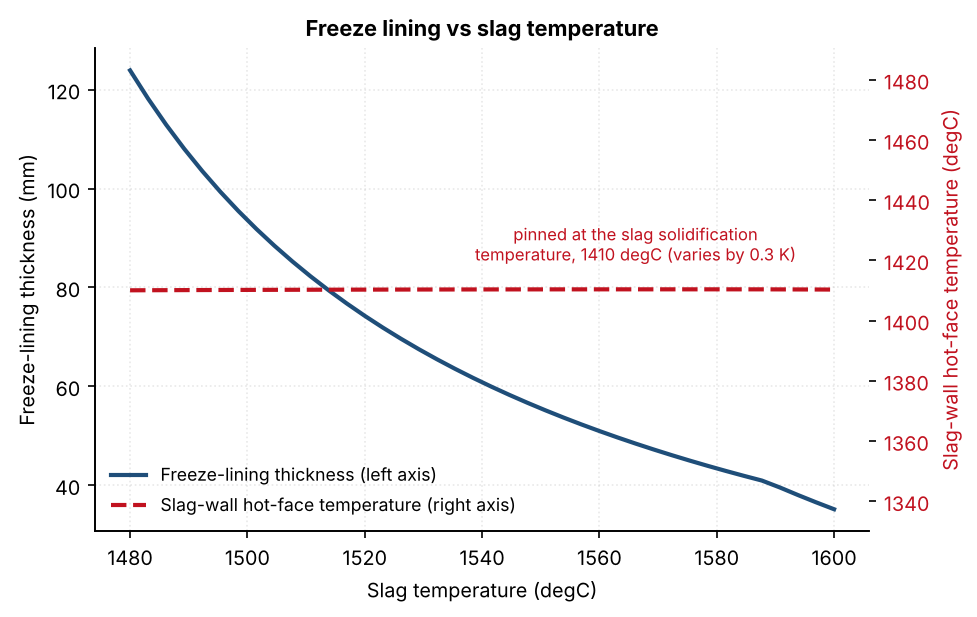
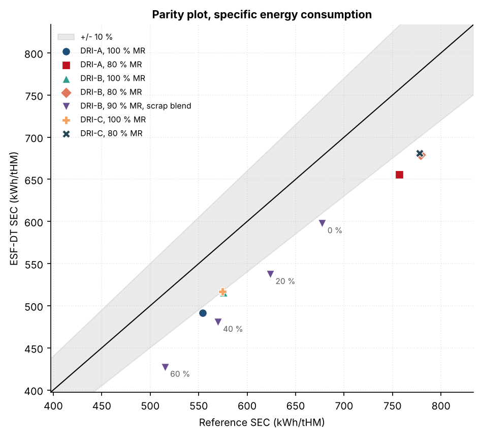

# Coupled steady-state and transient modelling of the electric smelting furnace for hydrogen-DRI ironmaking

**Ajay Shukla**^1,2,\*^

^1^ Department of Metallurgical and Materials Engineering, and Centre for Pyrometallurgy, Indian Institute of Technology Madras, Chennai 600036, India

^2^ Extractmet Private Limited, IIT Madras Research Park, Chennai 600113, India

\* Corresponding author.

---

## Abstract

The electric smelting furnace (ESF), configured as an open slag bath furnace, is the unit through which high-gangue direct reduced iron (DRI) must pass if the hydrogen direct reduction route is to use the ore grades that dominate world reserves. Published models of this furnace are almost exclusively steady-state equilibrium mass and energy balances, so the transient behaviour of the bath, the response of the refractory lining, and the systematic departure of measured product chemistry from thermodynamic prediction all remain unresolved.

This paper presents a coupled steady-state and transient model of the ESF formulated from conservation laws, measured thermophysical properties and reaction kinetics. The steady-state formulation closes the elemental mass balance and the energy balance simultaneously on a basis of 1000 kg of contained iron, and incorporates slag and metal equilibria for Si, Mn, P and S, a five-zone multilayer refractory network, an analytic freeze-lining criterion for the copper-cooled slag belt, and a slag-resistance electrical model. The transient formulation advances five coupled control volumes, comprising the feed pile, slag, metal, freeboard and lining, using kinetics expressed in mass-transfer form together with electrode regulation and discrete tapping.

A kinetic limitation formulation is developed for silicon, residual slag FeO and manganese. It resolves an inconsistency in the published data: one equilibrium study reports 0.62 wt % Si at 1525 degC and another 0.40 wt % Si at 1600 degC, which cannot both describe equilibrium for an endothermic reduction. Laboratory smelting under ESF conditions confirms that SiO2 reduction does not attain equilibrium. The model therefore reports silicon on both an equilibrium and a kinetically limited basis, the latter remaining within the industrial tapping specification of 0.5 wt % at all temperatures examined, while the former reproduces the equilibrium anchors between 1400 and 1525 degC.

The model is assessed against 52 independent benchmarks drawn from two equilibrium codes, a complete published stream balance, a supplier design envelope and laboratory experiments. Of these, 44 are single-valued comparisons and 8 are window tests against a published range. The mean absolute relative deviation over the single-valued comparisons is 8.53 % with a median of 4.96 %; 32 of the 44 lie within 10 %, and all 8 windows are satisfied. A separate comparison against industrial plant composition is reported as a consistency check rather than as validation, because the feed analysis had to be back-calculated from the published slag and three model constants were calibrated against the same table. A published stream-by-stream balance at 1600 degC is reproduced to within 0.5 % on specific energy consumption and 0.3 % on hot metal mass. For reference, the two published equilibrium codes differ from one another by 14.6 to 16.0 % on identical cases. Physical admissibility is verified independently over 178 configurations spanning the full input space.

**Keywords:** electric smelting furnace; open slag bath furnace; hydrogen direct reduced iron; process modelling; reaction kinetics; freeze lining; slag valorisation

---

## 1. Introduction

Electric steelmaking accounted for approximately 29 % of the 1885 Mt of crude steel produced in 2024, while world DRI production reached 144 Mt and remained concentrated in regions with access to low-cost natural gas [3,37]. As integrated steelworks plan the replacement of blast furnace ironmaking by hydrogen direct reduction, the melting of the resulting DRI becomes the critical process step.

The choice of melting unit is governed by ore quality. DRI produced from DR-grade pellets can be melted in an electric arc furnace (EAF). DRI produced from the high-gangue ores that dominate remaining reserves cannot be melted economically in an EAF, because the foaming slag practice requires a binary basicity B2 = CaO/SiO2 of approximately 2, which generates large slag volumes, and the associated FeO contents above 20 wt % incur a substantial loss of iron yield [3]. Visuri and Echterhof conclude that low-quality DRI is more economically processed in an ESF, with the hot metal subsequently refined in a basic oxygen furnace (BOF) [3].

A second consideration reinforces this conclusion. An ESF operates at B2 near unity, close to blast furnace slag, so its slag is expected to be usable as a supplementary cementitious material in the same manner as granulated blast furnace slag [3]. Slag valorisation therefore forms part of the economic case for the route rather than being incidental to it. Industrial commitment reflects these arguments: a pilot ESF has been commissioned in Pori, Finland, and the hydrogen direct reduction, ESF and BOF route has been announced for the Duisburg site [3].

### 1.1 Statement of the problem

Process modelling has not kept pace with this industrial activity. In a recent review of ESF modelling, Sabah et al. conclude that although an extensive body of work exists for submerged arc furnaces and EAFs, independent studies of open slag bath furnaces are limited, and that both the brush arc and the distribution of heat between parts of the process require modelling [1]. They further observe that commercial furnaces have not been independently characterised for productivity or energy efficiency, because supplier research remains unpublished and protected as intellectual property.

The published work that does exist consists predominantly of equilibrium mass and energy balances. Such models establish energy envelopes reliably, but they cannot describe the state of the bath between taps, the response of the lining to a process upset, or the reasons for which measured product chemistry departs from thermodynamic prediction. That departure is substantial. Bae and Park, smelting simulated hydrogen DRI under ESF conditions, computed a final slag basicity of C/S = 1.2 but measured approximately 0.5, and concluded that SiO2 reduction proceeded more slowly than expected and did not reach thermodynamic equilibrium [2].

### 1.2 Objectives and novelty

The objectives of this work are to formulate a model of the ESF resolving thermochemistry, heat and mass transfer, reaction kinetics, refractory behaviour and the electrical circuit in both steady-state and transient form; to assess that model against the widest set of published data presently available; and to reconcile, rather than arbitrate between, the inconsistencies contained within those data.

Four aspects of the work are believed to be new. First, a transient, physically resolved model of the open slag bath furnace is presented, addressing the gap identified in [1]. Second, an analytic criterion is derived for the sustainability of a freeze lining on a copper-cooled slag belt, converting a qualitative design requirement into a testable inequality. Third, a kinetic limitation formulation is developed for silicon, residual slag FeO and manganese, which reconciles two mutually inconsistent published datasets and reproduces industrial tapping practice. Fourth, physical admissibility across the full input space is verified independently of agreement with reference data.

### 1.3 Organisation of the paper

Section 2 reviews the relevant literature and identifies the specific gaps addressed. Section 3 presents the model, stating its assumptions and governing equations. Section 4 describes the numerical solution, including the solution algorithms and their convergence behaviour. Section 5 sets out the validation methodology, the reference datasets, the calibrated parameters and the statistical measures used. Section 6 presents and discusses the results. Section 7 states the conclusions.

---

## 2. Literature review

### 2.1 Process configuration and commercial status

Electric smelting furnaces have an established history in ferro-alloy and non-ferrous metal production [1]. High specific energy consumption relative to the blast furnace historically excluded them from iron production, a position reversed by decarbonisation requirements and declining ore quality. The open slag bath furnace (OSBF) configuration, in which a brush arc rather than a submerged arc transfers energy to the bath, is presented by furnace suppliers as among the more promising routes to hot metal [1].

Four commercial offerings are documented in the review literature. Metso Outotec market a DRI smelting furnace rated at 1.2 Mtpa hot metal and 112 MW design power, 35 m long and 11 m wide, claimed to accept any DRI feed, deliver high iron yield and accommodate large slag volumes [1,4]. Primetals Technologies offer a smelter accepting a wide range of inputs, capable of recycling iron-oxide-bearing by-products, with hot metal carbon adjustable for subsequent BOF operation [1,5]. SMS group have proposed a 2.5 Mt/year DRI plant coupled to three circular or two rectangular OSBFs [1,6]. The Tenova iBlue concept combines an OSBF with the Energiron direct reduction plant, with a published design specific energy consumption of 0.5 to 1.2 MWh/t and a slag to metal ratio of 0.07 to 0.25 [1,7]. These design envelopes are used as validation targets in Section 6.

### 2.2 Thermal design and the refractory lining

The zone-specific cooling requirements of the OSBF are described in the review [1]. The slag zone requires intensive cooling to establish a freeze layer that prevents contact between slag and refractory. The metal zone requires only moderate cooling and does not develop a freeze layer. The freeboard and roof require moderate to high cooling to withstand radiation from the open bath and the arc.

This description is qualitative, and its quantitative consequence has not previously been stated. If a freeze layer is to be the working lining of the slag belt, the thermal resistance of the refractory behind it must be low enough for the layer to be thermodynamically sustainable. Section 3.6 derives the corresponding criterion.

For an open bath furnace the heat rejected to the cooling circuit is a first-order term rather than a correction. Pan et al., modelling six-in-line electric furnaces for sulphide smelting, report that 35 to 45 % of the heat is absorbed by the cooling water [1,8].

### 2.3 Steady-state mass and energy balance models

Shahabuddin et al. developed a mass and energy balance model of a smelter in HSC Chemistry to examine the influence of ore gangue on process parameters [1,9]. Their operating window was a DRI flow rate of 1077 to 1190 kg per tonne of Fe, temperature 1300 to 1600 degC, metallisation ratio 90 to 100 wt %, basicity 1.1, carbon content 1 to 3.5 wt % and atmospheric pressure. The principal results, as reported in the review, are summarised in Table 1.

**Table 1.** Steady-state modelling results of Shahabuddin et al. as reported in [1], used here as validation targets.

| Quantity | Reported value |
|---|---|
| SEC at 90 wt % metallisation, 1300 degC | 706 kWh/tHM |
| SEC at 90 wt % metallisation, 1600 degC | 850 kWh/tHM |
| SEC, cold DRI from 7 wt % gangue ore, 100 % MR | 572 kWh/tHM |
| SEC, cold DRI from 16 wt % gangue ore, 100 % MR | 684 kWh/tHM |
| Sensitivity to hot metal carbon at 1500 degC | 10 kWh/tHM per 1.0 wt % |
| Sensitivity to ore gangue | 13 to 20 kWh/tHM per 1.0 wt % |
| Sensitivity to metallisation ratio | 12 kWh/tHM per 1.0 wt % |
| Sensitivity to scrap in blend at 1500 degC | 2.5 kWh/tHM per 1.0 wt % |

The review additionally tabulates a complete stream-by-stream balance at 1600 degC [1, Table 3] and a comparison of predicted hot metal and slag composition between the blast furnace and the open bath furnace [1, Table 1; 6]. Both are used as validation targets in Section 6. A parallel thermodynamic assessment of gangue content using FactSage has been reported by Owusu et al. [10] and provides the silicon against temperature and scrap blending datasets used here.

These studies share a common limitation. Being equilibrium formulations, they cannot represent rate-limited behaviour, and Section 2.4 shows that rate limitation is not a second-order effect in this process.

### 2.4 Experimental evidence on reaction behaviour

Bae and Park provide the only systematic experimental study of FeO reduction under ESF conditions presently available [2]. Their findings constrain the formulation developed in Section 3.

With solid carbon as the sole reductant, FeO reduction proceeded through incubation, steady-state and degradation stages, describing a sigmoidal curve consistent with earlier studies of FeO reduction by solid carbon [11-14]. The incubation period of approximately five minutes is attributed to confinement of the reaction to the carbon surface and to the time required for gas nucleation and growth. Despite carbon addition at a 1:1 molar ratio to FeO, the final FeO concentration decreased only to about 32 wt % after 60 minutes, the rate-controlling step having transferred to FeO diffusion within the slag.

A hot heel containing 2 wt % dissolved carbon eliminated the incubation period, produced a more rapid and more nearly linear decrease in FeO to approximately 3 wt %, and yielded hot metal containing 2.8 wt % carbon. The carbon requirement for complete FeO reduction with 3 wt % carbon in the hot metal was calculated as 66 kg-C/t-HM.

Three further observations bear on transient modelling. Solid carbon, being less dense than slag, can float and form a barrier that isolates it from the molten iron, so that the method of carbon charging influences both reduction and carburisation. MgO dissolution from the refractory increased as basicity decreased. Free MgO in the slag hydrates to Mg(OH)2 with a volume expansion that compromises slag reuse in cement.

The governing reactions and their standard Gibbs energies, as given in [2] after Turkdogan [15], are

$$\mathrm{FeO(l)} + \mathrm{C(s)} = \mathrm{Fe(l)} + \mathrm{CO(g)}, \qquad \Delta G^{\circ} = 141\,740 - 140\,T \ \mathrm{J\,mol^{-1}}$$

$$\mathrm{FeO(l)} + \mathrm{CO(g)} = \mathrm{Fe(l)} + \mathrm{CO_2(g)}, \qquad \Delta G^{\circ} = -24\,910 + 31.6\,T \ \mathrm{J\,mol^{-1}}$$

$$\mathrm{C(s)} + \mathrm{CO_2(g)} = 2\,\mathrm{CO(g)}, \qquad \Delta G^{\circ} = 166\,650 - 171\,T \ \mathrm{J\,mol^{-1}}$$

### 2.5 Electrical behaviour and computational fluid dynamics

Sheng et al., using a multielectrode probe within the slag of an electric furnace, measured a voltage drop of 100 to 120 V at the electrode interface for an applied potential between 180 and 230 V, attributed to an arc sustained by carbon monoxide evolved at the electrodes [1,16]. Karalis et al. demonstrated by three-dimensional CFD that slag electrical conductivity is among the properties governing process efficiency, Joule heating increasing both with electrode immersion depth and with conductivity over the range 10 to 60 S/m [1,17,18]. Bezuidenhout et al. found that 97.96 % of the heat generated was dissipated in the slag phase [1,19].

CFD studies resolve the arc and the flow field in detail but are computationally too demanding for campaign-length simulation. Zone-based process models of the EAF, reviewed by Hay et al. [20] and typified by Logar et al. [21,22], achieve campaign-length simulation but describe a furnace of different configuration. The present work adopts the zone-based architecture and adapts it to the OSBF.

### 2.6 Gaps addressed in this work

Table 2 summarises the specific gaps identified above and the sections in which each is addressed.

**Table 2.** Gaps identified in the literature and their treatment in this work.

| Gap | Evidence | Addressed in |
|---|---|---|
| No transient, physically resolved OSBF model in the open literature | Stated explicitly in [1] | Sections 3 and 4 |
| Freeze-lining requirement stated qualitatively only | Zone descriptions in [1] | Section 3.6 |
| Equilibrium prediction departs systematically from measured product chemistry | C/S of 0.5 measured against 1.2 predicted [2] | Section 3.5 |
| Published equilibrium datasets mutually inconsistent | Codes differ by 14.6 to 16.0 % [1]; silicon data inconsistent with an endothermic reduction | Section 6.4 |
| Model behaviour outside benchmarked conditions not established | General to the field | Section 5.5 |

---

## 3. Model formulation

### 3.1 Modelling approach and assumptions

The model is formulated from conservation laws and measured thermophysical properties rather than from plant correlations, so that it can be applied to ore grades for which no operating history exists. This is a requirement of the application: the hydrogen direct reduction route is intended to process ores that have not previously been smelted, and a data-driven formulation cannot extrapolate to them. The cost of this choice is a small number of constants that must be calibrated, all of which are listed in Section 5.3.

The steady-state and transient formulations share a single library of thermochemical and physical property data, so that the two cannot diverge and a correction made to either propagates to both.

Table 3 states the assumptions on which the formulation rests.

**Table 3.** Principal modelling assumptions.

| No. | Assumption | Justification |
|---|---|---|
| A1 | Each control volume is well mixed and spatially uniform | Bath circulation driven by gas evolution and buoyancy is vigorous; spatial resolution requires CFD and is outside the present scope |
| A2 | The refractory lining is quasi-steady | Lining thermal response time is long relative to the time step but short relative to a campaign |
| A3 | The freeboard has negligible thermal mass | Gas residence time is of the order of seconds |
| A4 | Melting occurs at the pile and slag interface | Consistent with continuous surface feeding; a lumped-pile treatment produces a non-physical stall |
| A5 | Slag behaves as a single homogeneous liquid phase above its liquidus | Solid phases are treated through the liquidus temperature and freeze layer rather than explicitly |
| A6 | Phosphorus is fully reduced to the metal | No oxidising slag is present under ESF conditions [2] |
| A7 | Gas phase composition is set by a prescribed post-combustion ratio | Detailed freeboard chemistry is outside the present scope |
| A8 | Electrode current distribution is uniform between electrodes | Resolving it requires the electromagnetic models reviewed in [1,17-19] |

### 3.2 System definition

The steady-state formulation uses a basis of 1000 kg of contained iron, so that results scale directly to unit hot metal production without reference to furnace size.

The transient formulation resolves five control volumes: the feed pile floating on the bath surface, the slag, the metal, the freeboard gas and the lining. Eleven elements are tracked across the charge, hot metal, slag, off-gas and dust streams: Fe, C, Si, Mn, P, S, Ti, Ca, Mg, Al and O.

Figure 1 shows the furnace as represented by the model, including the zone structure, bath levels, electrode immersion, brush arc and freeze lining. Table 4 gives the geometry and base-case operating conditions, which correspond to the commercial furnace described in [1,4].

![**Figure 1.** Representation of the electric smelting furnace in the model. Bath levels, electrode immersion, brush arc gap, freeze-lining thickness, temperatures and compositions are taken from the current solution. The zone structure follows the configuration described in [1].](figures/Fig1_furnace_schematic.png)

**Table 4.** Furnace geometry and base-case operating conditions.

| Parameter | Value | Parameter | Value |
|---|---|---|---|
| Hearth length | 35.0 m | Tapping temperature | 1500 degC |
| Hearth width | 11.0 m | Target hot metal carbon | 3.5 wt % |
| Hearth area | 385 m2 | Target slag basicity B2 | 1.10 |
| Number of electrodes | 6 | Target slag MgO | 8.0 wt % |
| Electrode diameter | 1.70 m | Slag superheat | 60 K |
| Electrode pitch | 4.60 m | Off-gas temperature | 1450 degC |
| Electrode immersion | 0.45 m | Carburiser | metallurgical coke |
| Brush arc gap | 0.09 m | Carburiser yield | 92 % |
| Slag depth | 1.35 m | Primary flux | burnt lime |
| Metal depth | 0.90 m | Secondary flux | dolomitic lime |
| Freeboard height | 3.20 m | Electrical to bath efficiency | 0.90 |
| Secondary voltage | 420 V | DRI feed rate, transient case | 160 t/h |
| Power factor | 0.86 | Rated power, transient case | 112 MW |

Table 5 gives the analyses of the DRI grades used. Grades A to C and HG are representative commercial analyses. The two BP grades are the simulated hydrogen DRI compositions smelted experimentally by Bae and Park [2] and are reproduced exactly.

Two grades are not taken unaltered from their sources and are identified as such. The Shahabuddin grade reproduces the feed of the published stream balance [1,9], whose stated analysis of Fe, SiO2, Al2O3, Mn and S sums to 99.80 wt %; the remaining 0.20 wt % has been assigned here to CaO, MgO, TiO2 and P2O5 so that the analysis closes. Removing those four constituents entirely changes the computed specific energy of Table 10 by 0.26 % and the slag mass by 0.19 %, so the assignment does not affect any conclusion. The OSBF grade is back-calculated from the published industrial slag [1,6]; its gangue oxides were chosen by the present author, with the consequences set out in Section 6.5.

Titanium is carried through the model because DRI from titaniferous ores contains it, but none of the reference sources reports titanium in either the feed or the product. The TiO2 entries in Table 5 are therefore representative values, no titanium quantity appears among the comparisons of Section 6, and the titanium treatment is unvalidated.

**Table 5.** Analyses of the DRI grades used, in wt %.

| Grade | Fe | FeO | SiO2 | Al2O3 | CaO | MgO | MnO | TiO2 | P2O5 | S |
|---|---:|---:|---:|---:|---:|---:|---:|---:|---:|---:|
| DRI-A | 86.22 | | 8.82 | 3.10 | 0.55 | 0.35 | 0.75 | 0.10 | 0.09 | 0.02 |
| DRI-B | 84.50 | | 9.77 | 3.42 | 0.55 | 0.40 | 1.05 | 0.20 | 0.09 | 0.02 |
| DRI-C | 84.05 | | 9.73 | 4.20 | 0.55 | 0.40 | 0.90 | 0.06 | 0.09 | 0.02 |
| DRI-HG | 92.85 | | 4.35 | 1.60 | 0.40 | 0.25 | 0.45 | 0.05 | 0.03 | 0.02 |
| DRI-Shahabuddin [1,9] | 84.05 | | 9.76 | 4.88 | 0.10 | 0.05 | 1.07 (as Mn) | 0.03 | 0.02 | 0.04 |
| H2-DRI-BP85 [2] | 76.80 | 17.40 | 3.50 | 2.10 | 0.14 | 0.10 | | | | |
| H2-DRI-BP88 [2] | 78.50 | 14.00 | 3.90 | 1.40 | 1.60 | 0.50 | | | 0.18 | 0.02 |
| DRI-OSBF | 87.85 | | 8.72 | 2.19 | 0.40 | 0.30 | 0.21 | 0.05 | 0.05 | 0.08 |

### 3.3 Thermochemistry and energy

Species enthalpies are integrated from Shomate-form heat capacities referenced to the standard enthalpy of formation [23,24]:

$$H_i(T) = \Delta H^{\circ}_{f,i}(298) + \int_{298}^{T} c_{p,i}\,\mathrm{d}T + \sum \Delta H_{\text{trans}} \tag{1}$$

Solutes that are liquid only by virtue of dissolution require the undercooled liquid branch of Eq. (1). Iron in hot metal at 1500 degC containing 3.5 wt % C lies 38 K below the melting point of pure iron; the enthalpy is therefore evaluated along the solid path to the melting point, through the latent heat, and back down the liquid heat capacity to the bath temperature. Neglect of this treatment under-predicts hot metal enthalpy by approximately 20 %.

Slag is not a mechanical mixture of pure oxides, and pure-oxide heats of fusion over-predict its heat content by a factor of approximately three. The slag enthalpy is expressed as a sensible term along the solid path to the liquidus, a latent term using effective heats of fusion in the silicate solution, and a superheat term:

$$h_{\text{slag}}(T) = \sum_i w_i\,[H_i(T_{\text{liq}}) - H_i(298)] + \sum_i w_i L_i^{\text{eff}} + c_p^{\ell}\,(T - T_{\text{liq}}) \tag{2}$$

A regular-solution mixing term is added to Eq. (2). The effective heats of fusion are substantially lower than pure-oxide values because the silicate network forms exothermically.

The process heat is the net enthalpy change between charge and tap together with the reaction enthalpies:

$$Q_{\text{process}} = \sum_{\text{out}} m_j h_j(T_j) - \sum_{\text{in}} m_j h_j(T_j) + \sum_k n_k \Delta H_k^{\text{rxn}} \tag{3}$$

Carbonate fluxes are charged as the carbonate rather than as the calcined oxide, so that the evolved CO2 and free moisture appear on the input side as well as in the off-gas:

$$H_{\text{in}} \mathrel{+}= n_{\mathrm{CO_2}} \Delta H^{\circ}_{f,\mathrm{CO_2}} - \Delta H_{\text{calc}} + m_{\mathrm{H_2O}}\!\left[h_{\mathrm{H_2O}}(T) - L_v\right] \tag{4}$$

The calcination endotherm then follows from the balance rather than requiring separate addition. Omission of Eq. (4) confers a spurious energy credit on carbonate fluxes.

Melting occurs at the interface between the feed pile and the slag:

$$\Delta h = c_p\,(T_{\text{soft}} - T_{\text{pile}}) + L, \qquad \dot{m}_{\text{melt}} = \frac{\dot{Q}_{\text{pile}}}{\Delta h} \tag{5}$$

The bulk pile temperature follows from an enthalpy balance including both the incoming charge and the enthalpy leaving with the melt, so that a cold or rapid feed depresses the pile temperature and retards melting.

### 3.4 Slag and metal equilibria

Silica activity, referenced to pure liquid silica, is represented by

$$\log \gamma_{\mathrm{SiO_2}} = -2.05\,(B_3 - 1) - 0.42\,\frac{(\mathrm{Al_2O_3})}{(\mathrm{SiO_2})} - 0.35, \qquad a_{\mathrm{SiO_2}} = \gamma\, x_{\mathrm{SiO_2}}^{2} \tag{6}$$

with $B_3 = (\mathrm{CaO}+\mathrm{MgO})/\mathrm{SiO_2}$ and a temperature correction $\exp[-3100(1/T - 1/1773)]$. The quasi-chemical exponent of two reproduces the steep decrease of silica activity with basicity. Solute activities in the metal use Wagner first-order interaction parameters [25]:

$$\log f_i = \sum_j e_i^{j}\,[\%j], \qquad h_i = f_i\,[\%i] \tag{7}$$

corrected to temperature by the factor $1873/T$. Silicon reduction is then

$$(\mathrm{SiO_2}) + 2[\mathrm{C}] = [\mathrm{Si}] + 2\{\mathrm{CO}\}, \qquad K = \frac{h_{\mathrm{Si}}\,p_{\mathrm{CO}}^{2}}{a_{\mathrm{SiO_2}}\,h_{\mathrm{C}}^{2}} \tag{8}$$

with $\Delta G^{\circ} = 581\,500 - 329.5\,T$ J mol^-1^. Manganese and phosphorus follow the analogous form, as does titanium, whose treatment is retained for completeness but is not validated here

$$(\mathrm{M_xO_y}) + y[\mathrm{C}] = x[\mathrm{M}] + y\{\mathrm{CO}\} \tag{9}$$

Sulphur partition uses the optical-basicity sulphide capacity correlation of Fincham and Richardson [26,27], converted through the oxygen activity fixed by the C-CO equilibrium:

$$L_S = \frac{(\%\mathrm{S})}{[\%\mathrm{S}]} = C_S\,\frac{1}{a_{\mathrm{O}}}\sqrt{\frac{1}{p_{\mathrm{O_2}}}} \tag{10}$$

### 3.5 Kinetic limitation of slag and metal reactions

Three product variables are determined in practice by the extent to which the slag and metal reactions proceed within the available residence time rather than by equilibrium. The experimental basis is the observation of Bae and Park that SiO2 reduction did not reach equilibrium, their slag attaining C/S of 0.5 against 1.2 predicted [2]; the industrial basis is the open bath furnace composition of [1,6].

For silicon a saturating ceiling is imposed:

$$[\%\mathrm{Si}] = S_c\left(1 - \exp\!\left(-\frac{[\%\mathrm{Si}]_{\text{eq}}}{S_c}\right)\right) \tag{11}$$

Equation (11) leaves low-temperature values essentially unaltered, since $[\%\mathrm{Si}] \to [\%\mathrm{Si}]_{\text{eq}}$ as the latter becomes small, and approaches the ceiling $S_c$ at high driving force. The default value of $S_c$ is 0.45 wt %, the industrial figure [1,6].

Equilibrium FeO in the slag is negligible at ESF carbon levels, whereas industrial slag contains 0.6 to 0.7 wt % [1,6]; a practical floor of 0.65 wt % is therefore applied. Equilibrium would transfer essentially all manganese to the metal, whereas industrial slag retains 0.15 to 0.30 wt % MnO [1,6]; manganese transfer is therefore bounded between 0.55 and 0.80 of that charged.

All three limits are model inputs, are reported alongside their equilibrium values, and may be set to zero to recover the purely thermodynamic result. Section 6.4 presents the evidence.

### 3.6 Refractory lining and freeze lining

Each of the five zones is solved as a one-dimensional multilayer wall. The heat flux through $n$ layers in series with an inner and an outer film is

$$\dot{q} = \frac{T_{\text{bath}} - T_{\text{sink}}}{\dfrac{1}{h_{\text{in}}} + \sum_{j=1}^{n} \dfrac{x_j}{k_j(\bar{T}_j)} + \dfrac{1}{h_{\text{out}}}} \tag{12}$$

Layer conductivities are evaluated at the mean temperature of each layer, so the node temperatures are obtained iteratively. The exposed slag surface radiates to the cooled panels above:

$$\dot{Q}_{\text{open}} = \varepsilon\,\sigma_{\text{SB}}\,A_{\text{bath}} \left(T_{\text{slag}}^{4} - T_{\text{hot face}}^{4}\right) \tag{13}$$

In the slag belt the bath delivers $h(T_{\text{bath}} - T_{\text{liq}})$ to the solidification front, and at steady state the same flux passes through the frozen layer and the lining behind it:

$$h\,(T_{\text{bath}} - T_{\text{liq}}) = \frac{T_{\text{liq}} - T_{\text{sink}}}{x/k_f + R_{\text{lining}}} \tag{14}$$

Solving Eq. (14) for the layer thickness gives

$$x = k_f\left[\frac{T_{\text{liq}} - T_{\text{sink}}}{h\,(T_{\text{bath}} - T_{\text{liq}})} - R_{\text{lining}}\right] \tag{15}$$

Equation (15) admits a positive solution only when

$$R_{\text{lining}} < \frac{T_{\text{liq}} - T_{\text{sink}}}{h\,(T_{\text{bath}} - T_{\text{liq}})} \tag{16}$$

Inequality (16) is a design criterion. A slag belt violating it cannot sustain a protective skull at any cooling intensity, and its refractory hot face necessarily operates above the slag liquidus, giving chemical wear in place of a frozen protective layer.

### 3.7 Electrical model

Current leaves an immersed electrode through two surfaces, the cylindrical side wall over the immersed length and the tip, and the two paths act in parallel.

For the side wall, current spreads radially outward from the electrode surface at radius $r$ to an effective boundary at radius $L_{\text{eff}}$, over the immersed length $h_{\text{imm}}$. Applying Ohm's law to a cylindrical shell of thickness $\mathrm{d}\rho$ and integrating,

$$R_{\text{cyl}} = \int_{r}^{L_{\text{eff}}} \frac{\mathrm{d}\rho}{\sigma\,2\pi\rho\,h_{\text{imm}}} = \frac{\ln(L_{\text{eff}}/r)}{2\pi\sigma\,h_{\text{imm}}} \tag{17}$$

$L_{\text{eff}}$ is taken as the lesser of half the electrode pitch, which sets the electrode-to-electrode path, and the distance from the electrode tip to the metal bath.

For the tip, the current constriction into the surrounding melt is the classical spreading resistance of a circular contact on a semi-infinite conductor, derived by Holm [38] and standard in contact and earthing theory:

$$R_{\text{tip}} = \frac{1}{4\sigma r} \tag{18}$$

The two paths combine in parallel, in series with the ohmic resistance of the electrode itself:

$$R_{\text{slag}} = \left(R_{\text{cyl}}^{-1} + R_{\text{tip}}^{-1}\right)^{-1} \tag{19}$$

The brush arc is represented by the standard linear arc characteristic, in which a fixed electrode fall is added to a column gradient proportional to arc length [39,40]:

$$U_{\text{arc}} = U_{\text{fall}} + E_{\text{col}}\,\ell_{\text{arc}} \tag{20}$$

with $U_{\text{fall}} = 40$ V for the combined cathode and anode falls and $E_{\text{col}} = 1250$ V m^-1^, within the 1000 to 1400 V m^-1^ range reported for arc columns at atmospheric pressure [39]. Equation (20) gives 100 to 120 V for arc gaps between 48 and 64 mm, which is the interface drop measured by Sheng et al. in an industrial furnace [16]. The base case of this work uses a larger gap of 90 mm and therefore a higher arc drop of 152 V against a tap voltage of 496 V, so the measurement of [16] constrains the form and coefficients of Eq. (20) rather than providing a direct comparison at the present operating point.

Slag electrical conductivity follows

$$\sigma = \sigma_0 \exp\!\left(-\frac{E_a}{RT}\right), \quad E_a = \left[110 - 55(\Lambda - 0.55) - 0.9\,((\mathrm{FeO}) + (\mathrm{MnO}))\right] \ \mathrm{kJ\,mol^{-1}} \tag{21}$$

calibrated to 20 to 45 S/m at 1550 degC, within the 10 to 60 S/m range employed in the CFD literature [17].

### 3.8 Reaction kinetics

Reaction rates in the transient formulation are expressed in mass-transfer form:

$$r = k\,A\,C\,\Delta, \qquad k = k_0\exp\!\left(-\frac{E_a}{RT}\right) \tag{22}$$

Table 6 lists the reactions, driving forces, interfacial areas and kinetic constants.

**Table 6.** Reactions resolved in the transient formulation.

| Reaction | Driving force | Interfacial area | $k_0$ (m s^-1^) | $E_a$ (kJ mol^-1^) |
|---|---|---|---:|---:|
| (FeO) + [C] = Fe + CO | $C_{\mathrm{FeO}}(1 - a_{\mathrm{FeO}}^{\text{eq}}/a_{\mathrm{FeO}})$ | slag and metal | 3.0 | 155 |
| (FeO) + C(char) | as above | char surface | 0.90 | 160 |
| (SiO2) + 2[C] | $[\%\mathrm{Si}]^{*} - [\%\mathrm{Si}]$ | slag and metal | 20.0 | 190 |
| (MnO) + [C] | $[\%\mathrm{Mn}]^{*} - [\%\mathrm{Mn}]$ | slag and metal | 5.5 | 180 |
| C(s) = [C] | $[\%\mathrm{C}]_{\text{sat}} - [\%\mathrm{C}]$ | char surface | 0.02 | 110 |

Two modifications follow from the experimental observations of [2]. Since part of the charged char floats on the slag, a contact efficiency $\eta_C$ reduces the effective char area, $A_{\text{char}}^{\text{eff}} = \eta_C A_{\text{char}}$. Since reduction by solid carbon requires prior nucleation of a gas film, the char reduction path is scaled by

$$f_{\text{inc}} = \theta + (1-\theta)\left[1 - \exp\!\left(-\frac{t}{\tau_{\text{inc}}}\right)\right], \qquad \theta = \min\!\left(1, \frac{[\%\mathrm{C}]}{[\%\mathrm{C}]_{\text{ref}}}\right) \tag{23}$$

Dissolved carbon in the hot heel drives $\theta$ towards unity and suppresses the incubation delay, reproducing the contrast between the two experimental conditions of [2]. Carbon consumed by reduction is drawn preferentially from floating char and only subsequently from carbon dissolved in the metal.

### 3.9 Flux demand

Two targets are set on the slag, its binary basicity and its MgO content, and two fluxes are available to meet them. The difficulty is that flux added to correct one target also enlarges the slag, which changes the other.

Let flux $j$ deliver, per kilogram charged and after calcination of any carbonate, masses $c_j$ of CaO, $g_j$ of MgO and $s_j$ of SiO2, with $b_j$ the total mass of slag-forming oxide it delivers. Let the slag present before any flux is added contain $S_{\mathrm{CaO}}$, $S_{\mathrm{MgO}}$ and $S_{\mathrm{SiO_2}}$ of those oxides and have total mass $S_0$. Here $S_{\mathrm{SiO_2}}$ is the silica remaining after the reduction of Eq. (8), not the silica charged.

The two targets are then simple statements of composition. Writing $m_1$ and $m_2$ for the unknown flux masses, the basicity target requires

$$S_{\mathrm{CaO}} + m_1 c_1 + m_2 c_2 = B_2\left(S_{\mathrm{SiO_2}} + m_1 s_1 + m_2 s_2\right) \tag{24}$$

and the MgO target, expressed as a mass fraction $x$ of the total slag, requires

$$S_{\mathrm{MgO}} + m_1 g_1 + m_2 g_2 = x\left(S_0 + m_1 b_1 + m_2 b_2\right) \tag{25}$$

The right-hand side of Eq. (25) contains the flux masses because the flux becomes part of the slag whose composition is being set. Collecting the unknowns on the left gives a linear system,

$$\begin{bmatrix} c_1 - B_2 s_1 & c_2 - B_2 s_2 \\[2pt] g_1 - x b_1 & g_2 - x b_2 \end{bmatrix} \begin{bmatrix} m_1 \\[2pt] m_2 \end{bmatrix} = \begin{bmatrix} B_2 S_{\mathrm{SiO_2}} - S_{\mathrm{CaO}} \\[2pt] x S_0 - S_{\mathrm{MgO}} \end{bmatrix} \tag{26}$$

which is solved directly for $m_1$ and $m_2$.

Each coefficient has a straightforward meaning. The term $c_j - B_2 s_j$ is the net gain in CaO per kilogram of flux $j$ after allowing for the silica that the same flux brings, so it is the effective basicity-raising power of that flux. Likewise $g_j - x b_j$ is the net MgO enrichment per kilogram, after allowing for the dilution caused by the flux adding to the slag mass.

This interpretation also identifies when no solution exists. If $g_j < x b_j$ for both fluxes, each dilutes the slag in MgO faster than it enriches it, the second row of Eq. (26) cannot be satisfied with positive flux masses, and the MgO target is unattainable with the chosen materials. The same applies to the first row if neither flux can raise basicity, which is the case when both are acid. The solution is therefore accepted only when $m_1 \geq 0$ and $m_2 \geq 0$; otherwise the basicity target is satisfied with whichever flux can meet it and the MgO target is reported as unattainable, as set out in Algorithm 1, lines 5 to 7.

Solving Eq. (26) directly, rather than iterating on an assumed slag mass, is what makes this behaviour explicit instead of appearing as a failure to converge.

### 3.10 Reported quantities

Closure is evaluated for every element:

$$\varepsilon_e = \frac{\left|\sum_{\text{in}} m_{e} - \sum_{\text{out}} m_{e}\right|}{\sum_{\text{in}} m_{e}} \times 100\,\% \tag{27}$$

Three specific energy consumptions are reported and are not interchangeable:

$$\mathrm{SEC}_{\text{rev}} = \frac{Q_{\text{process}}}{m_{\mathrm{HM}}}, \quad \mathrm{SEC}_{\text{eq}} = \frac{\mathrm{SEC}_{\text{rev}}}{\eta_{\text{th}}}, \quad \mathrm{SEC}_{\text{op}} = \frac{Q_{\text{process}} + Q_{\text{loss}}}{m_{\mathrm{HM}}\,\eta_{\text{el}}} \tag{28}$$

The reversible value is the thermodynamic minimum, the equilibrium-basis value is comparable with equilibrium-code output, and the operating value is the transformer duty.

The tapped slag is scored for use as a supplementary cementitious material on basicity, FeO content and free MgO, the last against an estimated saturation limit

$$(\mathrm{MgO})_{\text{sat}} \approx 4.0 + \frac{7.5}{B_2} + 0.08\,(\mathrm{Al_2O_3}) \tag{29}$$

Free MgO is penalised because it hydrates to Mg(OH)2 with a volume expansion that damages cement products [2].

---

## 4. Numerical solution

### 4.1 Structure of the solution

Figure 2 shows the solution procedure. The steady-state problem is a fixed point: flux demand depends on slag mass, slag mass depends on the extent of silica reduction, silica reduction depends on the silicon content of the metal, the silicon content depends on slag composition, and hot metal mass depends on all of them. The transient solution advances the five control volumes explicitly, calling the same property and equilibrium routines at each step.


### 4.2 Steady-state solution

The steady-state solution iterates on four coupled state variables: hot metal mass, carbon demand, silicon content and slag mass. Algorithm 1 gives the procedure.

**Algorithm 1.** Steady-state solution.

```
 1  set basis to 1000 kg contained Fe; speciate the charge
 2  initialise slag composition, hot metal mass, carbon demand, silicon
 3  repeat
 4      route gangue and carburiser ash to the slag
 5      solve flux demand from Eqs. (24) to (26)
 6      if no non-negative solution exists, satisfy B2 and
 7          report the MgO target as unattainable
 8      evaluate slag and metal equilibria, Eqs. (6) to (10)
 9      apply the kinetic limits of Section 3.5, Eq. (11)
10      bound Si by the silica available in the slag
11      evaluate carbon demand; divide by carburiser yield
12      update hot metal mass and slag mass
13      evaluate the residual, Eq. (30); damp if it stalls
14  until the residual falls below the tolerance
15  close the energy balance, Eqs. (1) to (5)
16  evaluate the three specific energies, Eq. (28)
17  solve the lining network and freeze lining, Eqs. (12) to (15)
18  solve the electrical operating point, Eqs. (17) to (21)
19  evaluate closure, Eq. (27), and the slag valorisation index, Eq. (29)
```

The convergence residual is the sum of relative changes in the four state variables between successive iterations:

$$\mathcal{R} = \sum_{i=1}^{4} \frac{\left|\phi_i^{(n)} - \phi_i^{(n-1)}\right|}{\max\!\left(\phi_i^{(n)}, \phi_i^{\min}\right)} \tag{30}$$

with $\phi_i^{\min}$ a floor preventing division by small quantities. The tolerance is $\mathcal{R} < 10^{-6}$.

Two features of Algorithm 1 require comment. Line 5 obtains the flux demand in closed form. Formulations that target a lagged estimate of slag mass diverge whenever the selected flux cannot deliver the MgO target, because the flux dilutes the slag more rapidly than it enriches it; writing the induced slag growth into the constraint, as in Eqs. (24) and (25), removes this behaviour and renders the infeasible case explicit at line 6. Line 13 applies adaptive damping, because at high scrap fractions, where silicon is fixed by the scrap rather than by equilibrium, the fixed point is approached in a limit cycle; reducing the relaxation factor when the residual ceases to decrease restores monotone convergence.

### 4.3 Transient solution

The transient solution uses explicit Euler integration with a default step of 10 s, well within the stability limit set by the fastest process, which is melting at the pile interface. Algorithm 2 gives the procedure.

**Algorithm 2.** Transient solution.

```
 1  initialise the five control volumes from the specified heel
 2  for t = 0 to t_end, step dt
 3      solve the electrical operating point, Eqs. (17) to (21), at the current
 4          slag conductivity, immersion depth and arc length
 5      if power control is by temperature, apply feed-forward from the
 6          melting demand and lining loss with a PI trim on metal temperature
 7      charge the feed to the pile
 8      re-solve the lining network periodically, Eqs. (12) to (15)
 9      melt at the pile and slag interface, Eq. (5)
10      partition the melt between metal, slag and floating char
11      advance the kinetics of Table 6, Eqs. (22) and (23)
12      advance the S, P and Ti partitions
13      close the energy balance on slag, metal and freeboard
14      service the metal and slag tapping schedules
15      evaluate alarm conditions and record any transition
16      write the trajectory record
17  end for
```

### 4.4 Convergence and computational cost

The steady-state solution converges in 25 iterations or fewer for every case examined, the most demanding being 60 wt % scrap at 25 iterations and the base case requiring 19. Solution takes about 2 ms when the lining loss is prescribed as a fraction and about 36 ms when the lining network is solved. A seven-hour transient campaign at a 10 s step takes 2.1 s. A parametric study of thirty steady-state cases therefore completes in well under a second, which permits the operating-window mapping presented in Section 6.

Step-size independence was confirmed by repeating the reference transient campaign at 5, 10 and 30 s. Campaign specific energy consumption varied by less than 0.02 % and productivity by less than 0.25 % across this range, so the default step introduces no significant discretisation error.

---

## 5. Validation methodology

### 5.1 Reference datasets

Forty-four independent comparisons are drawn from six sources, listed in Table 7. The sources span equilibrium computation, industrial plant data, a supplier design envelope and laboratory experiment, so that agreement is not established against a single class of evidence.

**Table 7.** Reference datasets.

| Class | Source | Quantities compared |
|---|---|---|
| Equilibrium code, FactSage | Owusu et al. [10] | SEC against metallisation for three DRI grades; [Si] against temperature; carbon consumption; slag rate; scrap blending; hot metal composition |
| Equilibrium code, HSC | Shahabuddin et al. [9], via [1] | SEC against temperature at 90 % MR; sensitivities to C, gangue, MR and scrap; complete stream balance at 1600 degC |
| Industrial plant | Belford et al. [6], via [1] | Open bath furnace hot metal and slag composition |
| Supplier design envelope | Tenova [7], via [1] | SEC range; slag to metal ratio |
| Laboratory experiment | Bae and Park [2] | Carbon requirement; slag FeO and hot metal carbon with a hot heel |
| Furnace heat balance | Pan et al. [8], via [1] | Fraction of energy rejected to cooling water |

Published ranges are reproduced verbatim throughout and are not widened; where a source states a single value, the comparison is made numerically rather than as a window test.

The two equilibrium studies differ from one another by 14.6 to 16.0 % on identical cases [1]. This figure establishes the reproducibility presently attainable in the field and is used as the reference standard throughout.

### 5.2 Basis of comparison

Each comparison is evaluated on the basis appropriate to the reference value, since a like-for-like comparison requires the model and the reference to describe the same condition.

Comparisons against the FactSage anchors of [10] are evaluated with the kinetic limits of Section 3.5 disabled, because those values are reported as equilibrium computations and are internally consistent with equilibrium, silicon increasing monotonically with temperature across the range reported.

Comparisons against industrial [1,6] and laboratory [2] data are evaluated with the kinetic limits active, since both describe rate-limited systems.

The stream balance of [1,9] requires a judgement. It is computed with an equilibrium code, but the silicon it reports, 0.40 wt % at 1600 degC, is lower than the 0.62 wt % reported at 1525 degC by the other code; as Section 6.4 shows, the two cannot both describe equilibrium for an endothermic reduction. The silicon in that balance is therefore not an equilibrium value, and the comparison is made on the kinetic basis. Evaluated instead on the equilibrium basis, the same comparison gives a deviation of 19.7 % on specific energy rather than 0.5 %, the difference arising almost entirely from the silicon and the silica it removes from the slag.

Maintaining these distinctions allows all classes of reference to be used without any one contaminating the other, and the basis used for each comparison is recorded in the supporting data.

### 5.3 Calibrated parameters

Table 8 lists every calibrated constant together with its calibration target. All other quantities, including heat capacities, enthalpies of formation, Gibbs energies, interaction parameters, transport correlations, the lining network and the electrical model, are used as published.

**Table 8.** Calibrated constants.

| Constant | Value | Calibration target |
|---|---|---|
| Effective heats of fusion in slag solution | tabulated | slag heat content 1.85 to 1.95 MJ/kg at 1550 degC |
| Slag mixing enthalpy scale | 0.15 | as above |
| Thermal utilisation, $\eta_{\text{th}}$ | 0.887 | ratio of reversible heat to published equilibrium-code SEC |
| SiO2 reduction, A term of $\Delta G^{\circ}$ | 581 500 J mol^-1^ | [Si] at 1400, 1500 and 1525 degC [10] |
| Slag conductivity, $\sigma_0$ and $E_a$ | Eq. (21) | 10 to 60 S/m [17] |
| Slag liquidus reference | 1673 K | CaO-SiO2-Al2O3-MgO liquidus surface |
| Sulphide partition limit | 20 | hot metal sulphur in reducing smelting practice |
| Silicon ceiling, $S_c$ | 0.45 wt % | industrial hot metal [1,6] |
| Residual slag FeO floor | 0.65 wt % | industrial slag [1,6] |
| Carbon contact efficiency, $\eta_C$ | 0.55 | carbon flotation reported in [2] |
| Kinetic pre-exponentials | Table 6 | intended for plant-specific fitting |

The thermal utilisation factor requires justification. Dividing the reversible heat by 0.887 reproduces the published equilibrium-code specific energy across all cases examined, and the ratio required varies only between 0.870 and 0.902 irrespective of metallisation ratio or DRI grade. A constant of this stability across independent cases is interpreted as the physical fraction of heat delivered to the bath that is retained in the products. It is nevertheless a calibrated quantity, is identified as such, and is reported as a separate tier in Eq. (28) rather than incorporated into a single specific energy.

### 5.4 Statistical measures

Agreement is quantified by the relative percentage deviation for each comparison $i$,

$$\mathrm{RPD}_i = 100 \times \frac{y_i^{\text{model}} - y_i^{\text{ref}}}{y_i^{\text{ref}}} \tag{31}$$

and by the mean absolute relative deviation over the $N$ comparisons,

$$\mathrm{MARD} = \frac{1}{N}\sum_{i=1}^{N} \left|\mathrm{RPD}_i\right| \tag{32}$$

Quantities for which the reference is stated as a range rather than a single value, such as the industrial composition specifications, are assessed as window tests and reported separately from the RPD statistics.

### 5.5 Verification of physical admissibility

Agreement with reference data establishes accuracy only at the conditions for which reference data exist. Since the model is intended for ore grades and operating points that have not been published, its behaviour elsewhere in the input space must be established independently.

A second procedure therefore evaluates whether each solution is physically possible, without reference to any published value. The criteria applied are: elemental closure better than 1 % for every element, Eq. (27); absence of negative or indeterminate masses; phase compositions summing to 100 %; all reported quantities within physically attainable ranges; convergence of Eq. (30); positive net process heat; and, for the transient solution, non-negative inventories and no indeterminate values in any trajectory.

The procedure covers 178 configurations: every DRI grade against every carburiser, every flux against every other flux, the operating envelope varied one parameter at a time, both heat-loss formulations, four furnace sizes, eight corner cases and thirteen transient campaigns. Configurations that are not physically operable, such as a flux pair in which neither member can raise slag basicity, are required to be rejected with a diagnostic rather than returned as a solution, and such rejection is recorded as correct behaviour.

---

## 6. Results and discussion

### 6.1 Overall agreement with reference data

Table 9 summarises the comparison across the 52 independent benchmarks, evaluated using Eqs. (31) and (32). The industrial comparison of Section 6.5 is excluded for the reasons given there. The mean absolute relative deviation of 8.53 % is smaller than the 14.6 to 16.0 % by which the two published equilibrium codes differ from one another on identical cases [1], so the model lies within the present reproducibility of the field. Figure 3 shows specific energy against metallisation ratio for the three reference DRI grades, and Figure 7 presents the parity plot across the comparison set.

**Table 9.** Summary of agreement across the 52 independent benchmarks. The industrial comparison of Section 6.5 is excluded.

| Measure | Value |
|---|---|
| Single-valued comparisons, $N$ | 44 |
| Window tests against a published range | 8 |
| Mean absolute relative deviation, MARD | 8.53 % |
| Median absolute relative deviation | 4.96 % |
| Comparisons within 10 % | 32 |
| Comparisons within 15 % | 34 |
| Largest single deviation | 41.1 % |
| Windows satisfied | 8 of 8 |
| Physically admissible configurations, Section 5.5 | 178 of 178 |

![**Figure 3.** Specific energy consumption against metallisation ratio for three DRI grades on the equilibrium basis, with published FactSage values at 80 and 100 % metallisation [10]. The source reports only these two metallisation levels, so the reference line connects them directly.](figures/Fig3_SEC_vs_metallisation.png)

### 6.2 Reproduction of a complete published stream balance

The most stringent single test available is the reproduction of an entire published balance to which the model was not fitted. Table 10 compares the predicted streams against the HSC-based balance at 1600 degC given in [1,9].

**Table 10.** Reproduction of the published stream balance at 1600 degC, 100 % metallisation, B2 = 1.10, 3.5 wt % C.

| Quantity | This work | Published [1,9] | RPD |
|---|---:|---:|---:|
| Hot metal | 1052.2 kg | 1055.0 kg | -0.3 % |
| Slag | 300.5 kg | 283.8 kg | +5.9 % |
| Specific energy consumption | 595.4 kWh/tHM | 598.2 kWh/tHM | -0.5 % |
| Slag SiO2 | 37.04 wt % | 37.75 wt % | -1.9 % |
| Slag CaO | 40.34 wt % | 41.63 wt % | -3.1 % |
| Slag Al2O3 | 20.16 wt % | 20.45 wt % | -1.4 % |
| Hot metal Fe | 95.04 wt % | 94.75 wt % | +0.3 % |
| Hot metal C | 3.50 wt % | 3.50 wt % | 0.0 % |
| Hot metal Si | 0.45 wt % | 0.40 wt % | +12.5 % |
| Hot metal Mn | 0.97 wt % | 1.20 wt % | -19.3 % |

Seven of the ten stream quantities agree to within 3.1 %, and specific energy consumption agrees to 0.5 %. Since this balance was computed with an independent thermochemical code and a different solution method, the agreement provides evidence that the energy formulation of Eqs. (1) to (5) is correct in absolute terms and not merely in trend. The manganese deviation is discussed in Section 6.5.

### 6.3 Energy sensitivities

Table 11 compares the predicted sensitivities of specific energy against the published values of Table 1. Figure 4 shows specific energy and hot metal silicon against tapping temperature.

**Table 11.** Sensitivity of specific energy consumption, equilibrium basis.

| Sensitivity | This work | Published [1,9] | RPD |
|---|---:|---:|---:|
| $\partial\,\mathrm{SEC}/\partial T$ per 25 degC | 14.0 kWh/tHM | 20.0 | -30 % |
| $\partial\,\mathrm{SEC}/\partial\mathrm{MR}$ per 1 wt % | -9.25 kWh/tHM | -12.0 | -23 % |
| $\partial\,\mathrm{SEC}/\partial[\mathrm{C}]$ per 1 wt % | 9.42 kWh/tHM | 10.0 | -5.8 % |
| $\partial\,\mathrm{SEC}/\partial(\text{gangue})$ per 1 wt % | 15.5 kWh/tHM | 13 to 20 | within range |
| $\partial\,\mathrm{SEC}/\partial(\text{scrap})$ per 1 wt % | -3.19 kWh/tHM | -2.5 | +28 % |

On the equilibrium basis the predicted specific energy is 743.7, 697.4, 651.2, 605.0 and 558.7 kWh/tHM at 80, 85, 90, 95 and 100 % metallisation, and 558.7, 585.4 and 586.4 kWh/tHM for grades DRI-A, DRI-B and DRI-C at full metallisation. Scrap blending at 90 % metallisation gives 677.7, 609.9, 546.3 and 486.4 kWh/tHM at 0, 20, 40 and 60 wt % scrap.

Absolute specific energies agree more closely than their derivatives. This is expected: derivatives amplify differences in the underlying thermochemical databases, which is precisely where the two published codes are known to diverge [1]. The sensitivity to hot metal carbon, which is governed by the enthalpy of carbon dissolution and the associated silicon pickup, agrees to 5.8 %.

![**Figure 4.** Specific energy consumption and hot metal silicon against tapping temperature, with published FactSage values [10]. Silicon varies by a factor of twenty across the range, providing a demanding test of the silica activity model, Eq. (6), and the reduction Gibbs energy, Eq. (8).](figures/Fig4_SEC_and_Si_vs_temperature.png)

### 6.4 Silicon transfer and the limits of equilibrium

Two published silicon values cannot both describe equilibrium. FactSage gives 0.62 wt % Si at 1525 degC [10] and HSC gives 0.40 wt % Si at 1600 degC [1,9]. Reduction of silica by carbon is strongly endothermic, so equilibrium silicon must increase monotonically with temperature; a lower value at the higher temperature is therefore inconsistent with equilibrium. Industrial practice supports the lower figure, the open bath furnace specification being below 0.5 wt % [1,6] against 0.75 wt % for the blast furnace it replaces.

The experimental evidence resolves the inconsistency. Bae and Park measured a slag basicity of approximately C/S = 0.5 where equilibrium predicted 1.2, and concluded that SiO2 reduction was slower than expected and did not reach thermodynamic equilibrium [2]. The discrepancy is therefore not an error in either computation but a consequence of applying an equilibrium assumption to a rate-limited transfer.

Table 12 presents the model on both bases.

**Table 12.** Hot metal silicon on the equilibrium and kinetically limited bases, wt %.

| Tapping temperature | Equilibrium, Eq. (8) | Kinetic, Eq. (11) | Reference value |
|---:|---:|---:|---|
| 1400 degC | 0.032 | 0.031 | 0.03 [10] |
| 1450 degC | 0.109 | 0.097 | 0.10 [10] |
| 1500 degC | 0.345 | 0.242 | 0.30 to 0.36 [10] |
| 1525 degC | 0.593 | 0.332 | 0.62 [10] |
| 1550 degC | 0.985 | 0.404 | below 0.5 [1,6] |
| 1600 degC | 2.155 | 0.449 | 0.40 [1,9] |

On the equilibrium basis the model reproduces the FactSage anchors between 1400 and 1525 degC, matching both magnitude and slope over a range in which silicon varies twentyfold. This establishes that the silica activity treatment of Eq. (6) and the reduction Gibbs energy of Eq. (8) are correct rather than fitted at a single condition.

On the kinetic basis the model reproduces the HSC value at 1600 degC to within 12.3 % and remains within the industrial specification at every temperature examined. The two bases differ by a factor of five at 1600 degC, where the equilibrium result of 2.16 wt % exceeds any composition reported from an operating ESF.

The practical consequence is specific to the DRI, ESF and BOF route. Silicon in the hot metal determines lime and oxygen demand in the downstream converter, so a fivefold over-prediction would propagate through the flowsheet mass balance. Reporting both bases is preferable to selecting one: the equilibrium basis is the appropriate comparator for equilibrium-code benchmarking, the kinetic basis is the appropriate predictor of plant behaviour, and the separation between them indicates how far a given operating point lies from thermodynamic control.

### 6.5 Consistency with industrial composition

The published industrial open bath furnace composition [1,6] is a tempting validation target, and it is used here, but it cannot serve as an independent test. Two obstacles prevent that, and both are stated before the comparison rather than after it.

First, the corresponding feed analysis is not published. It had to be back-calculated from the reported slag, so the gangue oxides in the feed were chosen by the present author to reproduce the slag against which the model is then compared. Second, three model constants, the silicon ceiling of Eq. (11), the residual slag FeO floor, and the manganese transfer bounds, were calibrated against this same table, as recorded in Table 8.

Table 13 therefore reports the comparison together with the provenance of each quantity, so that a reader can see which entries carry information and which do not.

**Table 13.** Consistency with industrial open bath furnace composition, [1, Table 1] after [6]. Published values are reproduced verbatim and have not been widened. The provenance column states what determines each model value.

| Quantity | This work | Published, OSBF | Result | Provenance |
|---|---:|---|:---:|---|
| Hot metal Fe | 94.88 wt % | 94.7 to 94.8 | outside | outcome of the overall balance, independent |
| Hot metal C | 4.500 wt % | 4.5 | 0.0 % | operating target set in the run |
| Hot metal Si | 0.414 wt % | below 0.5 | satisfied | ceiling calibrated to this table |
| Hot metal Mn | 0.141 wt % | 0.14 | +0.5 % | feed MnO chosen; bounds calibrated to this table |
| Hot metal S | 0.022 wt % | 0.025 to 0.03 | outside | feed S chosen |
| Hot metal P | 0.024 wt % | 0.02 to 0.03 | satisfied | feed P2O5 chosen |
| Slag CaO | 41.37 wt % | 40.5 to 41.5 | satisfied | flux target set in the run |
| Slag MgO | 7.27 wt % | 7.0 to 7.5 | satisfied | flux target set in the run |
| Slag SiO2 | 38.31 wt % | 36.5 to 37.5 | outside | feed SiO2 back-calculated |
| Slag Al2O3 | 11.14 wt % | 10.5 to 11.0 | outside | feed Al2O3 back-calculated |
| Slag FeO | 0.647 wt % | 0.6 to 0.7 | satisfied | floor calibrated to this table |
| Slag MnO | 0.191 wt % | 0.20 to 0.25 | outside | feed MnO chosen; bounds calibrated to this table |

Only one entry, hot metal iron, is an independent prediction, and it lies 0.08 percentage points above a published range that is itself only 0.1 wt % wide. Three entries are operating targets set in the run and test nothing. Four are calibrated against this table and are circular by construction. Four follow from feed constituents chosen by the author.

What the exercise does demonstrate is that a single self-consistent feed, flux schedule and set of constants reproduces an entire industrial product specification to within a few per cent on every quantity simultaneously, which is a necessary condition for the model to be usable even though it is not a sufficient one for validation. It also shows where the residual tensions lie. Slag SiO2 and Al2O3 exceed their ranges by 2.2 % and 1.3 % relative, which means no single gangue ratio reproduces both the silica and the alumina of the published slag; the feed was not adjusted further to force agreement. Slag MnO falls 0.009 wt % below its range because the manganese bounds restrict transfer to at most 0.80 of the manganese charged, and raising that bound to close the gap would be circular twice over.

The equilibrium result is worse on the same test. Without the manganese bounds, essentially all manganese transfers to the metal and slag MnO falls to 0.055 wt %, further from the published range than the bounded result.

For these reasons the twelve entries of Table 13 are excluded from the validation statistics of Table 9, which rest on the equilibrium codes, the published stream balance, the supplier envelope and the laboratory experiment alone.

### 6.6 Comparison against laboratory smelting

Table 14 compares the model against the laboratory smelting of low-grade hydrogen DRI reported in [2].

**Table 14.** Comparison against laboratory smelting of low-grade H2-DRI [2].

| Quantity | This work | Measured [2] | RPD |
|---|---:|---:|---:|
| Carbon for complete FeO reduction with 3 wt % C | 59.0 kg-C/tHM | 66 kg-C/tHM | -10.6 % |
| Slag FeO with a hot heel | 4.23 wt % | approximately 3.0 wt % | +41 % |
| Hot metal C with a hot heel | 3.23 wt % | 2.8 wt % | +15 % |

The carbon requirement, which follows from the stoichiometry of FeO reduction together with carburisation and the carburiser yield, agrees to 10.6 %. The remaining two comparisons set a 500 g laboratory melt against a model parameterised for a 112 MW furnace, and are reported as indicative. The qualitative effect of the hot heel, namely the elimination of the incubation period and a more rapid approach to low slag FeO, is reproduced by Eq. (23).

### 6.7 Thermal behaviour and the refractory lining

Table 15 gives the computed zone heat losses at base-case conditions, and Figure 5 the through-lining temperature profiles from which they follow. Figure 6 shows the response of the freeze layer to slag temperature.

**Table 15.** Zone heat losses at 1550 degC slag and 1500 degC metal.

| Zone | Area (m2) | Flux (kW m^-2^) | Duty (MW) | Hot face (degC) | Shell (degC) | Freeze layer (mm) |
|---|---:|---:|---:|---:|---:|---:|
| Hearth | 385.0 | 1.8 | 0.70 | 1499 | 178 | none |
| Metal wall | 82.8 | 2.2 | 0.18 | 1499 | 197 | none |
| Slag wall | 124.2 | 36.2 | 4.49 | 1405 | 40 | 53 |
| Roof | 404.2 | 37.7 | 15.23 | 1488 | 40 | none |
| Freeboard | 294.4 | 31.5 | 9.28 | 1493 | 39 | none |
| Total | | | 29.88 | | | |

Of the total, 97 % is rejected to the cooling water. At the design power of 110 MW the lining loss represents 27 % of the input, below the 35 to 45 % reported by Pan et al. [8]. The difference is attributable to the default lining specification, which carries more hot-face refractory over the water-cooled panels than the reference furnaces; reducing the roof hot-face thickness brings the model within the reported band.

The slag wall hot face is computed at 1405 degC, coincident with the slag liquidus, confirming that the frozen layer rather than the refractory constitutes the working lining in that zone. No freeze layer develops in the metal zone. Both outcomes are consistent with the zone descriptions in [1] and were obtained without prescribing them.

Inequality (16) gives this result design significance. For the base-case slag belt the right-hand side evaluates to a limiting lining resistance above which no frozen layer can be sustained. A slag belt constructed with conventional refractory thickness exceeds that limit, so its hot face must operate above the liquidus regardless of cooling intensity, and the protective mechanism assumed in the design cannot be realised. Since relining represents a major capital event, a criterion evaluable during design from lining thickness, conductivity and coolant temperature has practical value.






### 6.8 Transient behaviour over a tapping campaign

A seven-hour campaign was simulated at 160 t/h DRI feed and 112 MW rated power, with metal tapped hourly and slag half-hourly. Table 16 summarises the result and Figure 8 gives the trajectories.

**Table 16.** Seven-hour transient campaign at base-case conditions.

| Quantity | Value |
|---|---:|
| Hot metal produced | 1002 t |
| Productivity | 143.2 tHM/h |
| Operating specific energy consumption | 707 kWh/tHM |
| Mean active power | 102.8 MW |
| Mean lining loss | 30.7 MW (29.9 % of input) |
| Mean hot metal temperature | 1499 degC |
| Final hot metal C, Si, Mn, S, P | 3.41, 0.24, 0.52, 0.011, 0.044 wt % |
| Final slag FeO | 1.80 wt % |
| Final slag basicity B2 | 1.073 |
| Freeze layer thickness | 76 mm |
| Maximum shell temperature | 197 degC |

The operating specific energy of 707 kWh/tHM lies within the Tenova iBlue design envelope of 500 to 1200 kWh/tHM [1,7], as does the slag to metal ratio. The campaign comprises seven metal taps and fourteen slag taps. Following the initial heating transient, the feed-forward and PI control of Algorithm 2, lines 5 and 6, holds the hot metal temperature to a mean deviation of 1.8 K from setpoint, with a maximum excursion of 6.0 K immediately after a metal tap.

The trajectories in Figure 8 show the characteristic behaviour of the continuous process. Slag FeO falls from its initial value and stabilises near 1.8 wt % once the carbon supply and the FeO input from the feed reach balance. Hot metal carbon approaches 3.4 wt % as carburisation and consumption by reduction equilibrate. Bath inventories exhibit the expected sawtooth from discrete tapping, and the freeze layer thickens slightly as the campaign proceeds and the slag composition shifts towards its steady value.


### 6.9 Physical admissibility across the input space

All 178 configurations defined in Section 5.5 satisfy the admissibility criteria. Elemental closure is better than 1 part in 10^5^ per cent for the base case and better than 2 parts in 10^5^ per cent at 60 wt % scrap, the most demanding case examined. No configuration produced a negative or indeterminate quantity, and every case converged within the iteration limit.

The procedure also confirmed that infeasible configurations are correctly rejected. A flux pair in which both members are acid cannot raise slag basicity, and Eqs. (24) to (26) admit no non-negative solution; the solver returns a diagnostic identifying the cause rather than a converged but meaningless result.

### 6.10 Limitations and uncertainty

Three classes of limitation apply.

The first is structural. Each control volume is spatially uniform, so the model cannot resolve current distribution between electrodes, the slag flow field, or local overheating near the electrode tips. Refractory wear driven by local conditions therefore lies outside its scope, and coupling to the electromagnetic and CFD approaches reviewed in [1,17-19] is the natural extension. Freeboard chemistry is represented by a prescribed post-combustion ratio and slag foaming by an index that is not fed back to the electrical operating point. Titanium is treated by an empirical reduction fraction rather than explicit Ti(III) and Ti(IV) speciation, and, since no reference source reports titanium, that treatment is carried by the model but is not validated by any comparison in this work; predictions of titanium partition should not be relied upon.

The second concerns parameter uncertainty. The three kinetic limits of Section 3.5 are calibrated against industrial composition specifications rather than derived from measured transport coefficients. Their values are therefore specific to the operating window from which those specifications derive, and extrapolation beyond it is not supported. Propagating the reported width of the industrial silicon specification through Eq. (11) gives a variation of approximately 0.1 wt % in predicted hot metal silicon at 1600 degC, which is the dominant uncertainty in that quantity. A mechanistic treatment based on measured slag and metal mass-transfer coefficients would remove this limitation and is the clearest route to improving the model.

The third concerns the reference data. The temperature sensitivity of specific energy remains approximately 30 % below the published slope, although absolute values at each temperature agree closely, and the cause has not been isolated. The laboratory comparisons of Table 14 compare scales differing by five orders of magnitude in mass. The industrial comparison of Table 13 relies on a back-calculated feed, since the corresponding analysis is not published.

### 6.11 Implications for process design and operation

Three results bear directly on the design and operation of the DRI, ESF and BOF route.

Silicon must be predicted on a kinetic rather than an equilibrium basis if the downstream converter is to be sized correctly. The difference reaches a factor of five at the upper end of the tapping range.

The freeze-lining criterion of inequality (16) should be evaluated at the design stage. It is inexpensive to apply and determines whether the protective mechanism assumed for the slag belt can operate at all.

The slag valorisation index of Eq. (29) links operating settings to the reuse value of the slag. At base-case conditions the tapped slag satisfies all three criteria, whereas at the basicity of approximately 2 required by EAF foaming practice it fails the basicity criterion. This quantifies the argument of [3] that the ESF route produces a slag suitable for cement use whereas an EAF processing the same feed does not.

---

## 7. Conclusions

A coupled steady-state and transient model of the electric smelting furnace has been formulated from conservation laws, measured thermophysical properties and reaction kinetics. It resolves thermochemistry, heat and mass transfer, a five-zone refractory network with an analytic freeze-lining criterion, reaction kinetics in mass-transfer form, and a slag-resistance electrical circuit, and it addresses the absence of independent transient models of the open slag bath furnace identified in the recent review literature.

The following specific conclusions are drawn.

1. Assessed against 52 independent benchmarks spanning two equilibrium codes, a published stream balance, a supplier design envelope and laboratory experiment, the model gives a mean absolute relative deviation of 8.53 % with a median of 4.96 % over the 44 single-valued comparisons. Thirty-two of those lie within 10 %, and all 8 window tests against published ranges are satisfied. The two published equilibrium codes differ from one another by 14.6 to 16.0 % on identical cases. A comparison against industrial plant composition is reported separately as a consistency check, because it is not independent of the model's own calibration.

2. A complete published stream-by-stream mass and energy balance at 1600 degC is reproduced to within 0.5 % on specific energy consumption and 0.3 % on hot metal mass, with seven of ten stream quantities within 3.1 %.

3. Two published silicon datasets are shown to be mutually inconsistent with equilibrium, since together they require silicon to decrease with increasing temperature for an endothermic reduction. The kinetic limitation formulation of Eq. (11) reproduces the equilibrium anchors on an equilibrium basis and industrial tapping practice on a kinetic basis, the two differing by a factor of five at 1600 degC. Equivalent treatments are required for residual slag FeO and for manganese.

4. The freeze-lining energy balance yields inequality (16), a criterion determining whether a protective frozen layer can be sustained on a given slag belt. A belt violating it operates with its refractory hot face above the slag liquidus irrespective of cooling intensity.

5. Physical admissibility was verified over 178 configurations spanning the full input space, independently of agreement with reference data. All configurations satisfied the criteria, and infeasible configurations were correctly rejected with a diagnostic.

6. At base-case conditions the tapped slag satisfies all three criteria for use as a supplementary cementitious material, whereas at the basicity required by EAF foaming practice it does not, quantifying the slag valorisation argument for the ESF route.

Priorities for further work are the direct measurement of slag and metal mass-transfer coefficients under ESF conditions to replace the calibrated kinetic limits; coupling to an electromagnetic representation of the brush arc; extension of the freeboard to a reacting gas-phase model; and calibration against a full industrial campaign, for which the kinetic pre-exponentials of Table 6 are the intended fitting parameters.

---

## Nomenclature

| Symbol | Definition | Unit |
|---|---|---|
| $a_i$ | thermodynamic activity of species $i$ | dimensionless |
| $A$ | interfacial area | m2 |
| $b$ | total oxide delivered per unit flux mass | dimensionless |
| $B_2$, $B_3$ | binary and ternary basicity | dimensionless |
| $c$, $g$, $s$ | CaO, MgO and SiO2 delivered per unit flux mass | dimensionless |
| $c_p$ | specific heat capacity | J kg^-1^ K^-1^ |
| $C_S$ | sulphide capacity | dimensionless |
| $e_i^j$ | Wagner first-order interaction parameter | dimensionless |
| $E_a$ | activation energy | J mol^-1^ |
| $f_i$ | Henrian activity coefficient of solute $i$ | dimensionless |
| $f_{\text{inc}}$ | incubation scaling factor | dimensionless |
| $h$ | heat-transfer coefficient | W m^-2^ K^-1^ |
| $h_i$ | Henrian activity of solute $i$ | wt % |
| $H_i$ | molar enthalpy of species $i$ | J mol^-1^ |
| $k$ | mass-transfer coefficient | m s^-1^ |
| $k_f$ | thermal conductivity of the frozen layer | W m^-1^ K^-1^ |
| $K$ | equilibrium constant | dimensionless |
| $L^{\text{eff}}$ | effective heat of fusion in slag solution | J kg^-1^ |
| $L_S$ | sulphur partition ratio | dimensionless |
| $m$ | mass | kg |
| $\dot{q}$ | heat flux | W m^-2^ |
| $Q$ | heat | W or J |
| $R_{\text{lining}}$ | thermal resistance of the lining | m2 K W^-1^ |
| $\mathcal{R}$ | convergence residual, Eq. (30) | dimensionless |
| $S_c$ | silicon kinetic ceiling | wt % |
| $T_{\text{liq}}$ | slag liquidus temperature | K |
| $x$ | frozen layer thickness | m |
| $\varepsilon_e$ | closure error on element $e$ | % |
| $\eta_C$ | carbon contact efficiency | dimensionless |
| $\eta_{\text{th}}$, $\eta_{\text{el}}$ | thermal utilisation and electrical-to-bath efficiency | dimensionless |
| $\theta$ | hot heel index, Eq. (23) | dimensionless |
| $\Lambda$ | optical basicity | dimensionless |
| $\sigma$ | electrical conductivity | S m^-1^ |
| $\sigma_{\text{SB}}$ | Stefan-Boltzmann constant | W m^-2^ K^-4^ |
| $\tau_{\text{inc}}$ | incubation time constant | s |
| $\phi_i$ | state variable in the convergence test | various |

**Abbreviations.** BOF, basic oxygen furnace; CFD, computational fluid dynamics; DRI, direct reduced iron; EAF, electric arc furnace; ESF, electric smelting furnace; MARD, mean absolute relative deviation; MR, metallisation ratio; OSBF, open slag bath furnace; RPD, relative percentage deviation; SEC, specific energy consumption; tHM, tonne of hot metal.

---

## Declarations

### Use of generative artificial intelligence

During the preparation of this work the author used Claude, a large language model developed by Anthropic, for the following purposes: writing and debugging the source code implementing the model described here; executing the numerical experiments, parametric studies and verification procedures, and tabulating their output; and drafting and editing the text of this manuscript.

The author defined the scope of the work, selected the physical formulation, chose and interpreted the validation data, and verified every numerical result reported. All output of the tool was reviewed and edited by the author, who takes full responsibility for the content of this paper. The tool does not satisfy the criteria for authorship and is not listed as an author, and no element of the scientific judgement reported here was delegated to it.

### Funding

To be completed by the author.

### Conflict of interest

The author is a director of Extractmet Private Limited, which develops and licenses software implementing the model described in this paper.

### Data availability

The validation tables, figures and trajectories reported here are generated directly from the model. Reference data are taken from the cited publications. Plant references are anonymised.

---

## References

1. Sabah, S., Kudaru, U., Brooks, G., Rhamdhani, M.A., Owusu, K., Kumar, B., Chen, C., Guiraud, A. (2026) Modeling of electric smelting furnaces for ironmaking: a review. *Journal of Sustainable Metallurgy*. https://doi.org/10.1007/s40831-026-01575-z

2. Bae, S.J., Park, J.H. (2025) Sustainable hot metal production by solid and liquid carbon from H2 direct reduced iron (H2-DRI) in electric smelting furnace (ESF) conditions. *Journal of Cleaner Production* **524**, 146490. https://doi.org/10.1016/j.jclepro.2025.146490

3. Visuri, V.-V., Echterhof, T. (2025) Electric arc furnace steelmaking. *Metals* **15**, 1285. https://doi.org/10.3390/met15121285

4. Metso (2024) DRI smelting furnace. https://www.metso.com/portfolio/dri-smelting-furnace/

5. Wimmer, G., Rosner, J., Fleischanderl, A. (2022) Two steps towards net zero carbon? Primetals Technologies Austria GmbH.

6. Belford, B., Reuter, L., Kleier, T. (2022) Green steel with open bath furnaces. *Steel Times International*, pp. 64-68.

7. Esterhuizen, A., Tenova (2024) iBlue open slag bath furnace: fundamental designs for a DRI smelter. In: *South African Pyrometallurgy 2024*, Southern African Institute of Mining and Metallurgy, Johannesburg.

8. Pan, Y., Sun, S., Jahanshahi, S. (2011) Mathematical modelling of heat transfer in six-in-line electric furnaces for sulphide smelting. *Journal of the Southern African Institute of Mining and Metallurgy* **111**(10), 717-732.

9. Shahabuddin, M., Rahbari, A., Sabah, S., Brooks, G., Pye, J., Rhamdhani, M.A. (2024) The performance and charge behaviour in melter/smelter for the production of hot metal in hydrogen DRI-based steelmaking. *Ironmaking & Steelmaking*. https://doi.org/10.1177/03019233241265179

10. Owusu, K., Kumar, B., Chen, C., Guiraud, A., Sabah, S., Kudaru, U., Rhamdhani, M.A., Brooks, G. (2026) Thermodynamic assessment of gangue content in hydrogen-direct reduced iron smelting in electric smelting furnaces. *Journal of Sustainable Metallurgy*. https://doi.org/10.1007/s40831-026-01622-9

11. Min, D.J., Han, J.W., Chung, W.S. (1999) A study of the reduction rate of FeO in slag by solid carbon. *Metallurgical and Materials Transactions B* **30**(2), 215-221. https://doi.org/10.1007/s11663-999-0050-5

12. Teasdale, S.L., Hayes, P.C. (2005) Kinetics of reduction of FeO from slag by graphite and coal chars. *ISIJ International* **45**(5), 642-650. https://doi.org/10.2355/isijinternational.45.642

13. Htet, T.T., Yan, Z., Khasraw, D., Hage, J., Meijer, K., Li, Z. (2023) Kinetic study on reduction of FeO in a molten HIsarna slag by various solid carbon sources. *Metallurgical and Materials Transactions B* **54**(1), 163-177. https://doi.org/10.1007/s11663-022-02677-1

14. Min, D.J., Fruehan, R.J. (1992) Rate of reduction of FeO in slag by Fe-C drops. *Metallurgical Transactions B* **23**, 29-37. https://doi.org/10.1007/BF02654033

15. Turkdogan, E.T. (1980) *Physical Chemistry of High Temperature Technology*. Academic Press, New York.

16. Sheng, Y., Irons, G.A., Tisdale, D.G. (1998) Transport phenomena in electric smelting of nickel matte: Part I. Electric potential distribution. *Metallurgical and Materials Transactions B* **29**, 77-83. https://doi.org/10.1007/s11663-998-0009-y

17. Karalis, K., Karkalos, N., Cheimarios, N., Antipas, G.S.E., Xenidis, A., Boudouvis, A.G. (2016) A CFD analysis of slag properties, electrode shape and immersion depth effects on electric submerged arc furnace heating in ferronickel processing. *Applied Mathematical Modelling* **40**(21-22), 9052-9066. https://doi.org/10.1016/j.apm.2016.05.045

18. Karalis, K., Karalis, N., Karkalos, N., Ntallis, N., Antipas, G.S.E., Xenidis, A. (2021) Three-dimensional computational fluid dynamics analysis of an electric submerged arc furnace. *Scientific Reports* **11**, 17637. https://doi.org/10.1038/s41598-021-96085-1

19. Bezuidenhout, J.J., Eksteen, J.J., Bradshaw, S.M. (2008) CFD modelling of molten matte and slag flows in a circular 3-phase smelting furnace. *Progress in Computational Fluid Dynamics*. https://doi.org/10.1504/PCFD.2009.027362

20. Hay, T., Visuri, V.-V., Aula, M., Echterhof, T. (2021) A review of mathematical process models for the electric arc furnace process. *Steel Research International* **92**, 2000395. https://doi.org/10.1002/srin.202000395

21. Logar, V., Dovzan, D., Skrjanc, I. (2012) Modeling and validation of an electric arc furnace: Part 1, heat and mass transfer. *ISIJ International* **52**(3), 402-412. https://doi.org/10.2355/isijinternational.52.402

22. Logar, V., Dovzan, D., Skrjanc, I. (2012) Modeling and validation of an electric arc furnace: Part 2, thermo-chemistry. *ISIJ International* **52**(3), 413-423. https://doi.org/10.2355/isijinternational.52.413

23. Chase, M.W. (1998) *NIST-JANAF Thermochemical Tables*, 4th edn. Journal of Physical and Chemical Reference Data, Monograph 9. https://doi.org/10.18434/T42S31

24. Barin, I. (1995) *Thermochemical Data of Pure Substances*, 3rd edn. VCH, Weinheim. https://doi.org/10.1002/9783527619825

25. Sigworth, G.K., Elliott, J.F. (1974) The thermodynamics of liquid dilute iron alloys. *Metal Science* **8**(1), 298-310. https://doi.org/10.1179/msc.1974.8.1.298

26. Fincham, C.J.B., Richardson, F.D. (1954) The behaviour of sulphur in silicate and aluminate melts. *Proceedings of the Royal Society of London A* **223**(1152), 40-62. https://doi.org/10.1098/rspa.1954.0099

27. Park, G.H., Kang, Y.B., Park, J.H. (2011) Sulfide capacity of the CaO-SiO2-MnO slag at 1873 K. *ISIJ International* **51**(9), 1375-1382. https://doi.org/10.2355/isijinternational.51.1375

28. Urbain, G. (1987) Viscosity estimation of slags. *Steel Research* **58**(3), 111-116. https://doi.org/10.1002/srin.198700595

29. Turkdogan, E.T. (1984) Physicochemical aspects of reactions in ironmaking and steelmaking processes. *Transactions of the Iron and Steel Institute of Japan* **24**(8), 591-611. https://doi.org/10.2355/isijinternational1966.24.591

30. Pang, Z., Liu, W., Zheng, J., Xue, Q., Wang, J., Zuo, H. (2025) Properties evaluation of electric smelting furnace slag: viscosity and sulfide capacity under different FeO content. *Ceramics International* **51**(1), 593-601. https://doi.org/10.1016/j.ceramint.2024.11.037

31. Sabah, S., Kudaru, U., Brooks, G., Rhamdhani, M.A., Owusu, K., Kumar, B., Chen, C., Guiraud, A. (2026) Application of electric smelting furnace to ironmaking. *Journal of Sustainable Metallurgy*. https://doi.org/10.1007/s40831-026-01459-2

32. Ono, H., Tanizawa, K., Usui, T. (2011) Rate of iron carburization by carbon in slags through carbon/slag and slag/metal reactions at 1723 K. *ISIJ International* **51**(8), 1274-1278. https://doi.org/10.2355/isijinternational.51.1274

33. Heo, J.H., Park, J.H. (2022) Interfacial reactions between magnesia refractory and electric arc furnace (EAF) slag with use of direct reduced iron (DRI) as raw material. *Ceramics International* **48**(4), 4526-4538. https://doi.org/10.1016/j.ceramint.2021.10.238

34. Yu, Y., Li, B., Yun, C., Qi, F., Liu, Z. (2021) Modeling on reduction reaction of metal oxides for submerged arc furnace in ferrochrome pellets smelting process. *Metallurgical and Materials Transactions B* **52**, 3907-3919. https://doi.org/10.1007/s11663-021-02304-5

35. Chen, Y., Luo, Q., Silaen, A.K., Zhou, C.Q. (2020) Multi-physics modeling of steel ingot melting by electric arc plasma and its application to electric arc furnace. *Frontiers in Materials* **7**, 576831. https://doi.org/10.3389/fmats.2020.576831

36. Pei, M., Petajaniemi, M., Regnell, A., Wijk, O. (2020) Toward a fossil free future with HYBRIT: development of iron and steelmaking technology in Sweden and Finland. *Metals* **10**, 972. https://doi.org/10.3390/met10090972

37. World Steel Association (2025) *World Steel in Figures 2025*. World Steel Association, Beijing.

38. Holm, R. (1967) *Electric Contacts: Theory and Application*, 4th edn. Springer, Berlin. https://doi.org/10.1007/978-3-662-06688-1

39. Bowman, B., Kruger, K. (2009) *Arc Furnace Physics*. Verlag Stahleisen, Dusseldorf.

40. Jordan, G.R., Bowman, B., Wakelam, D. (1970) Electrical and photographic measurements of high-power arcs. *Journal of Physics D: Applied Physics* **3**(7), 1089-1099. https://doi.org/10.1088/0022-3727/3/7/305
